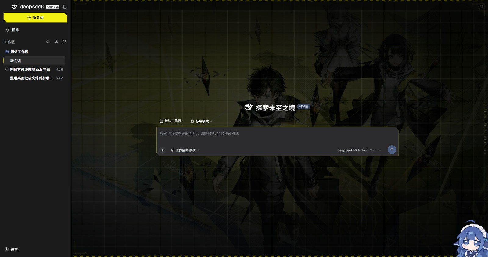
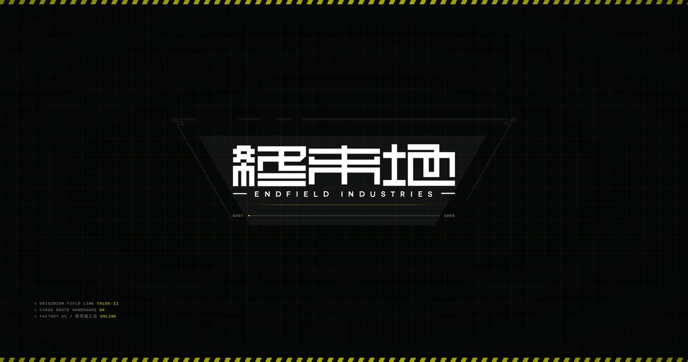
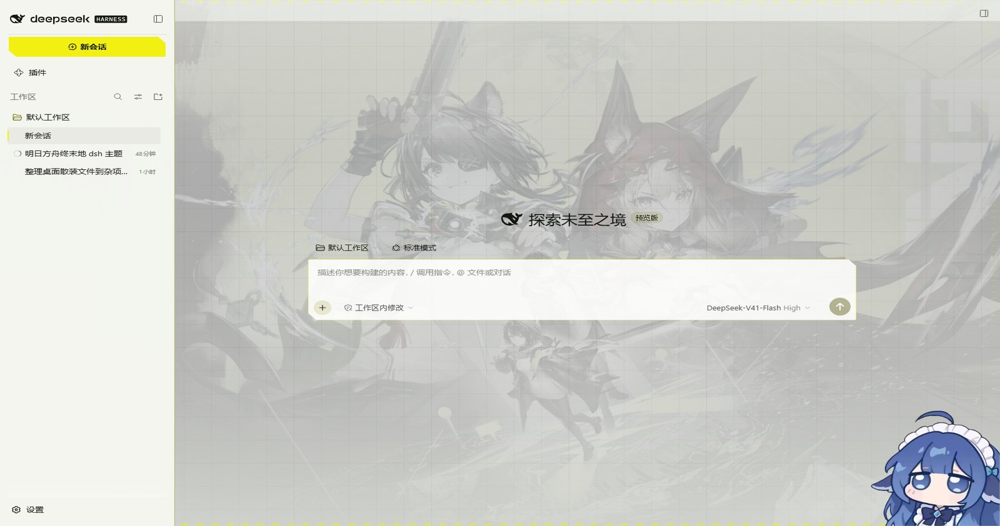
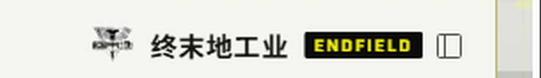

# 终末地主题 for DeepSeek Harness

[](https://www.npmjs.com/package/dsh-endfield-theme)
[](LICENSE)

《明日方舟：终末地》风格的 DSH 客户端主题：炭黑 + 警戒黄工业 HUD、开机开屏动画、可选的对话区底图，
以及把账户余额画成"电力储备"的侧栏读数。设置项统一收在自己的一个分页里。

```
npm 包名    dsh-endfield-theme
仓库        github.com/Longxiangjunlin/dsh-endfield-theme
```



## 它做了什么

- **开屏动画** —— 每次加载播一次，约 2.9 秒。网格与磁带先亮，徽记以横向擦除展开，BOOT 进度条
  与百分比读数同步推进，右下角打出 `FACTORY OS` 与站名，然后整屏收起。
- **对话区底图** —— 内置四档（炭灰原画 / 雪原 / 等高线 / 纯色），也可以放自己的图片。
- **侧栏电力储备** —— 把账户余额画成电量计，带状态词（`NOMINAL` / `OUTPUT LOW` / `DEPLETED`）、
  今日消耗、以及"还能撑几天"的折算。点标题可以折成一行（`¥6.06`），再点展开，折叠状态会记住；
  它停靠在侧栏左下，并会为工作区列表让出底部空间——列表变长时是自己滚动，而不是被面板压住。
- **余额语音播报** —— 低于阈值或耗尽时播一次，四种播报版本可选。
- **对话轮次索引** —— 对话左侧的轮次号，从 `data-chat-turn` 读，没有脚本遍历正文。
- **屏幕细纹** —— 静态扫描线，不占每帧预算。
- **设置页** —— 设置对话框里多一个「终末地主题」分页，17 项，含配置导出/导入与一键清除。
- **品牌位** —— 侧栏左上换成终末地 lockup（可关）。

这是一个 **host-only** 插件：`cordis.patch.yml` 里没有 `dsh.client` facet，因此注册不了官方设置页，
主题自己扩展设置对话框的 DOM；也正因为如此，它不需要数据库、不写入 profile，
除"读取自带底图/清除数据"外不碰磁盘。

## 安装

**从 npm（推荐）** —— 走 registry，不需要 Git，国内可直连（npmmirror 已同步）：

```sh
dsh plugin --profile desktop add dsh-endfield-theme
```

**从 GitHub** —— 等价，但需要能连上 github.com：

```sh
dsh plugin --profile desktop add github:Longxiangjunlin/dsh-endfield-theme
```

**本地改代码**用 link 装，之后改 `client/` 下的文件刷新页面即生效：

```sh
dsh plugin --profile desktop add link:<本仓库绝对路径>
```

若提示找不到 `dsh`：它装在 DSH 安装目录下的 `resources\runtime\cli\bin\dsh.cmd`，不在 PATH 里；
或者直接用客户端界面「设置 → 插件 → 添加插件」按包名安装。

### 升级

客户端插件**不支持自动更新**。两条路：

1. **市场更新**：设置 → 插件 → 已安装 → 更新。它会自己从 npm 的 `latest` 取版本、按具名版本安装，
   并带上 `--config.minimum-release-age=0`，所以**能绕过 pnpm 的 24 小时新包冷静期**。
2. **先卸再装**：按包名重装会受冷静期影响——发布不足 24 小时的版本 pnpm 不会选，它会退回上一个
   通过冷静期的版本。

### 卸载

- 界面：设置 → 终末地主题 →「清除数据」→ 确认。它会把自己从 profile 的 `package.json`
  （依赖与 bundles）和 `cordis.patch.yml` 里删掉，清空本地数据，并撤掉页面上的元素；重启客户端后
  彻底消失。写配置前会把两个文件备份成 `*.ef-uninstall-backup`。
- 命令行：`dsh plugin --profile desktop remove dsh-endfield-theme`。

## 屏幕

| 开屏 | 浅色 |
| --- | --- |
|  |  |

| 品牌位（深色） | 品牌位（浅色） |
| --- | --- |
|  |  |

## 设置页

17 项设置，存在 `localStorage`，改完即时生效。**开屏 / 品牌位 / 开屏音效三项例外**，
要重启客户端才生效（桌面端没有刷新按钮，所以说明里直接写"重启"）。

| 分组 | 项 | 默认 | 说明 |
| --- | --- | --- | --- |
| 开屏 | 开屏动画 | 开 | 每次加载播一次，约 2.9 s |
| | 开屏音效 | 开 | 与开屏同步，缺失或不允许播放时静默 |
| 外观 | 替换侧栏品牌位 | 开 | 换成终末地 lockup |
| | 屏幕细纹 | 开 | 静态扫描线 |
| | 细纹强度 | 22% | 0 = 关闭 |
| | 轮次索引 | 开 | 对话左侧的轮次号 |
| | 对话区背景 | 开 | 有对话内容时显示底图 |
| | 对话区底图 | 原画 | 四档内置 + 自备图片 |
| 电力储备 | 侧栏电力储备 | 开 | 关掉则**不轮询**，播报随之停 |
| | 余额刷新间隔 | 60 s | 最小 15 s |
| | 余额语音播报 | 开 | |
| | 播报版本 | 完整 | 完整 / 简短 / 提示音 / 自定义 |
| | 播报时长 | 2.5 s | 仅「自定义」生效，0.5–10 s |
| | 播报音量 | 90% | 拖动即试听 |
| | 预警阈值 | ¥5 | 低于它播报一次 |
| | 余额可用天数 | 0（关） | 按最近一周消耗速度折算 |
| | 电量计满量程 | 4× | 阈值 × 这个倍数 = 满格 |

**强关联的项收成一组，起决定作用的当主项**，从属项跟着缩进：

```
开屏动画 ─┬─ 开屏音效
替换侧栏品牌位
屏幕细纹 ─── 细纹强度
轮次索引
对话区背景 ─── 对话区底图
侧栏电力储备 ─┬─ 余额刷新间隔
             ├─ 余额语音播报 ─┬─ 播报版本 ─── 播报时长
             │                └─ 播报音量
             ├─ 预警阈值
             ├─ 余额可用天数
             └─ 电量计满量程
```

这些是真依赖，不是视觉分组：开屏关掉就没有音效可听；电力储备关掉就不轮询，播报一起停；
阈值为 0 时"满量程 = 阈值 × N"没有意义。判据是**主项的值是否为真**，唯一的例外是「播报时长」——
它只对"自定义"这一种播报版本有意义，属于等值判断，单独一张表处理。

主项关掉时从属项**变灰并且真的 `disabled`**（不是 `pointer-events` 障眼法，键盘也不该够到一个
没有作用的控件）。变灰而不隐藏，来回切主项时页面不会在手底下跳。

底部还有：**试听警告音**（两个按钮，走和真实预警同一条播放路径）、**配置**（重置 / 导出 / 导入；
导入只接受本版本认识的键且类型一致）、**清除数据**（自卸载）。

**面板为什么需要"让位"。** 侧栏里唯一能滚的是工作区列表，而电力储备是 `position: fixed` 的浮层，
停靠左下时会压在列表下沿——列表再长也只是继续往下长，最后几行永远被盖住。所以停靠时把面板高度
再加上一点间距，作为**那个列表的 `margin-bottom`**：列表的盒子因此在面板上沿结束，内容超了就是它
自己滚动（实测塞入溢出内容后 `scrollHeight 834 > clientHeight 330`，滚到底最低一行停在面板上方
30px）。用 margin 而不是 padding 是量出来的——padding 不会移动这个元素的底边（它的 `scrollHeight`
始终等于 `clientHeight`），margin 才会真的把弹性盒子的下沿提起来。

**折叠**是同一件事的另一半：展开时面板 116px，折起来 48px，让出的空间随之从 134px 回到 66px。
折叠不移动面板，只是把"仪表 + 状态词 + 今日消耗"换成标题行里的一个数字——浮层放到窗口中间会显得
没归位，收起来则不会。标题条既是点击目标也是键盘目标（`role="button"` + Enter/Space），因为折起来
之后它是唯一还看得见的东西。

## 余额读数

数据来自 DSH 自己的 `deepseekAccount.getBalance`，经宿主的一条路由转发；插件不碰凭据，
也不假定投影的形状。实际载荷是：

```json
{ "ok": true, "balance": { "status": "ready",
    "value": [ { "currency": "CNY", "balance": "17.22" } ],
    "bonusWallets": [ { "currency": "CNY", "balance": "0" } ] } }
```

可消费的是 `value`（一个**裸数组**），`bonusWallets` **从不计入**——赠金与充值余额是两回事，
算进去会高估可用余额。

**电量计**：满量程 = 预警阈值 × 倍数（默认 4），预警点因此固定落在四分之一处。

**今日变化**：账号服务只报一个余额，"今天花了多少"只能自己记基线再相减。跨自然日、
或余额**上升**（充值）时重置基线，所以刷新不会把测量从错误的数字重新开始。花钱显示 `−`，
充值显示 `+`。

**余额可用天数**：用最近一周的轮询采样算消耗速度，剩余不足设定天数时也触发预警。它与金额阈值
**并列**，不替代——¥5 对不同消耗速度的人意义不同。速率取窗口**两端**的差值，而不是逐对平均：
期间充值会让逐对平均失真，而两端相减在充值时直接得到负消耗，于是报"无法估算"而不是"余额很多"。
告警唯一不能答错的方向就是这一边。

**两条触发共用同一个边沿**：低余额只响一次，回升后重置，下次再跌再响；填 0 关掉天数触发。

**播报版本**四种：

| 版本 | 长度 | 做法 |
| --- | --- | --- |
| 完整语音 | 约 9 s | 原样播放 |
| 简短 | 约 2.4 s | 同一份素材在播放时截断，末尾 0.3 s 淡出 |
| 提示音 | 0.5 s | WebAudio 合成的两声，不占体积 |
| 自定义 | 0.5–10 s | 自己填秒数 |

## 浅色模式

浅色不是"反色"，而是把外壳调色板换成雪原一套（炭黑文字、`#6B6A00` 一类的强调色），并
**把主题自己画的每个部分都重新量过对比度**——那些颜色原本是照着炭黑侧栏写的。实测
（`rgb(244,246,240)` 为底，WCAG 正文要求 4.5）：

| 元素 | 曾经 | 现在 |
| --- | --- | --- |
| 面板标题「电力储备」 | 1.04 | 16.64 |
| 余额数字（警戒黄） | 1.12 | 5.23 |
| POWER RESERVE / NOMINAL / 今日 | 1.96 | 5.94 |
| 设置页副标题 | 1.22 | 5.49 |
| 数值读数 22% / 90% / 4x | 1.22 | 5.69 |
| 试听 / 重置 / 导出 等按钮 | 1.22 | 均高于 5.49 |
| 输入框占位符 | 2.75 | 4.79 |

设置页 51 个带文字的节点现在全部达标，最差 5.49。

两处不是"加一条覆盖"能解决的：**占位符**用的是外壳的 `--dsw-alias-label-caption`，主题把它设成
了偏浅的灰；**开关的填充**在 `::after` 上，只改外框会留下一块纯黄方块。**输入光标**同样是警戒黄——
一条 1px 竖线对对比度的要求本来就比正文高，浅色下改为墨黑，深色下提到更亮的黄。

## 几处非显然的做法

**开屏走 index 注入行，而不是脚本事后搭。** 原版没有独立开屏环节，要成为**首帧**就必须在外壳渲染
之前进 DOM，所以 `webserver/index-inject` 里加的是一条内联脚本（内联行不可能加载失败；桌面端的
注入表在插件 live 之前就采集完了，一个会失败的 `script-src` 行会把整个启动拖死）。

**顶部 40 px 那条带子重新切过。** 那一条上原本压着三层（窗口控制探针、外壳顶栏、对话区顶栏），
主题做的不是给第三层上色，而是让探针停笔、由第一层按面板对齐。

**输入卡上不能裁剪。** 外壳把「+」的添加菜单渲染在输入卡**内部**（菜单容器是卡片的后代），
所以卡片上的 `clip-path` 会把菜单**从绘制里移除而保留布局盒**——菜单存在、位置正确、永远看不见，
按钮看起来是坏的。切角因此画在 `::before` 上（叶子节点，裁不到子元素），并且必须 `z-index: -1`
画在内容**之下**，否则会盖住卡片自己的图标。同一类问题的另一半是 `backdrop-filter`：它会把容器
变成 fixed 后代的包含块。**给别的主题作者的一句话：不要在容器上拿
`clip-path` / `overflow: hidden` / `mask` 做造型。**

**底图机制随包，图片不随包。** 角色立绘属于鹰角，把官方美术打进一个 MIT 包不是这个项目做的事。
所以内置只有本仓库已有的两张主视觉，加上脚本生成、无版权问题的等高线；其余图片由使用者放进
`~/.dsh/endfield-backdrops/`，按文件名出现在同一个下拉里。实现上底图走 `--ef-art` 变量，覆盖写在
`body` 的内联属性（样式表按明暗各定义一套，内联才压得住）；选「原画」时是**移除**覆盖，
默认仍然是默认。

**等高线是算出来的。** 一个覆盖整幅画布的高度场（几组低频正弦叠加，横向频率刻意低于纵向），
用 **marching squares** 抽等值线——线条横贯全图、该闭合处闭合、永不交叉。段落在写出前接回折线、
用隐式 lineto 输出，整张图 70 KB。`tools/make-contour.mjs` 可重跑，结果确定。

## 文件结构

```
lib/index.js                   宿主半区：前缀路由（静态文件 / 余额 / 底图列表与文件）、注入行
cordis.patch.yml               bundle patch：插入 id dsh-endfield-theme
client/theme.js                浏览器半区：开屏、背景、电力储备、设置页
client/theme.css               深色 / 浅色两套，含外壳控件的主题化
client/splash.html             开屏骨架（注入到 index）
client/splash.css              开屏动画
client/assets/
  endfield-field.jpg           深色主视觉（1920×1080，烘过的）
  endfield-field-day.jpg       雪原主视觉
  endfield-contour.svg         等高线（脚本生成）
  endfield-emblem.webp         徽记，除文字外颜色对调，开屏底纹
  endfield-lockup-{dark,light}-bg.png  侧栏品牌位，两套底色
  endfield-mark-{zh,en}.png    字标
  endfield-icon.svg            站点图标
  endfield-boot.mp3            开屏音效
  endfield-low-power.mp3       余额预警音
  endfield-no-power.mp3        余额耗尽音
  fonts/                       Noto Sans SC / Saira 子集 + 两份 OFL 许可证
test/host.test.mjs             宿主半区测试：路由、注入行、守卫、卸载、底图
preview/                       README 用的截图
NOTES.md                       设计记录与实测数据
NOTICE.md                      授权：哪些素材不属于 MIT
```

## 开发与验证

```sh
npm test        # node test/host.test.mjs
```

测试挂在假的 cordis root 上跑宿主半区：路由、注入行、同源与 MIME 守卫、卸载时对 profile 的改动
（合成一个还含**别的插件**的 profile，断言只删自己的）、底图路由的列表与字节。`npm pack` 按 `files`
白名单打包，所以它还能对**打包后的产物**再跑一遍：`DSH_ENDFIELD_PKG=<解包目录> npm test`。

主题的多数改动只能对着真实页面验证。`tools/` 里放着做这件事的脚本：无头 Chromium 经 CDP 连上
Web GUI，真实点击、量计算样式、用 `elementsFromPoint` 取实际绘制层、截图。本文档里的对比度数字、
"哪个元素盖住了哪个"、播放时长，都是这样量出来的，不是估的。

测试还有一道护栏：拒绝**被 GBK 往返破坏过的文字**（中文 Windows 的 `Get-Content` 会这么干）
和带 BOM 的文件。

## 授权

代码 MIT。**美术与语音素材不属于 MIT**——它们来自鹰角/终末地及其二次创作，出处、版权归属与分发
条件见 [`NOTICE.md`](NOTICE.md)。fork 或再打包时，那份同人非商业的义务随文件一起走。
「终末地工业 / ENDFIELD INDUSTRIES」是鹰角的商标，本仓库不主张它。
